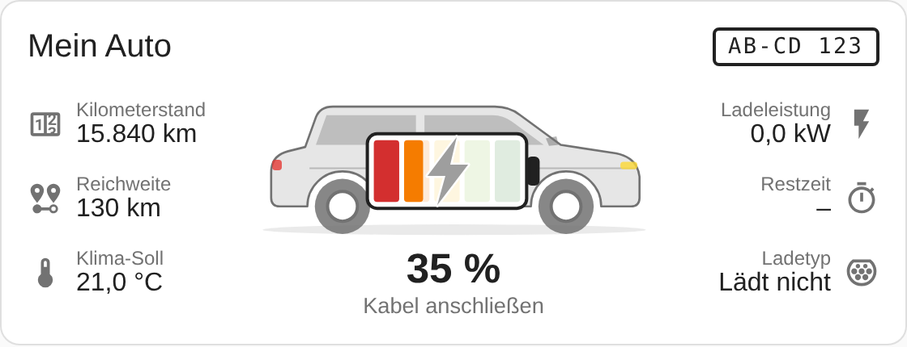
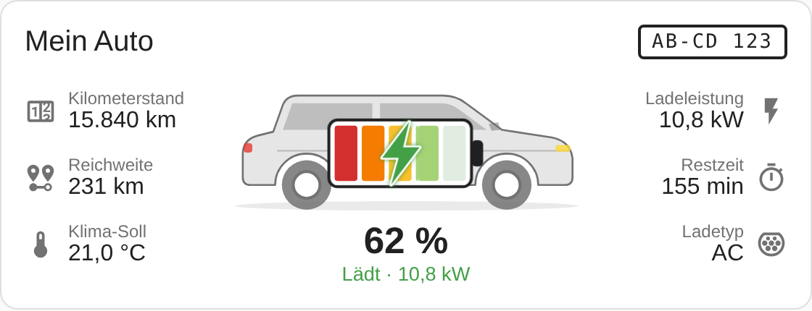
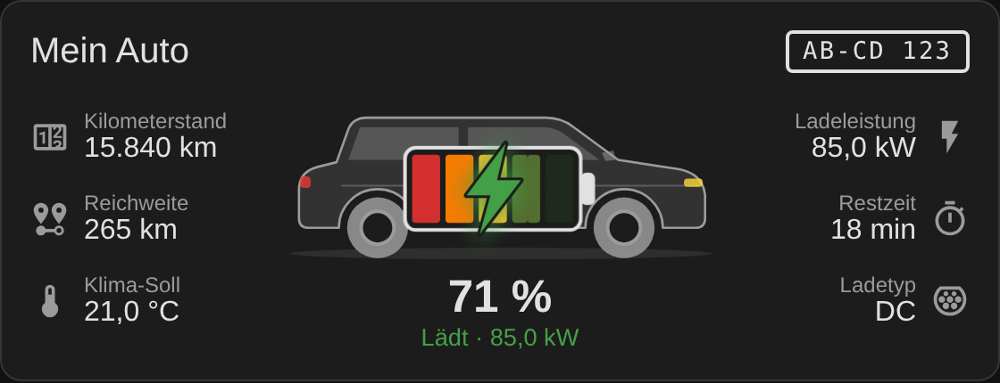
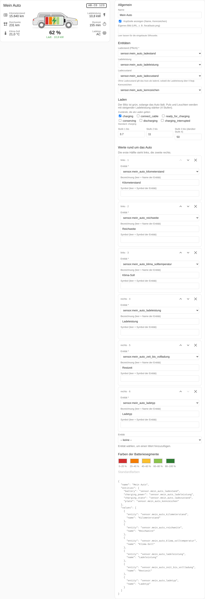

# car-info-card

[English](README.md) · **Deutsch**

Home-Assistant-Dashboard-Karte für ein E-Auto: allgemeine SUV-Silhouette, darüber eine Batterie mit 5 Segmenten (je 20 %, rot → dunkelgrün) und einem Blitz. Der Blitz ist grau, wenn das Auto nicht lädt, und grün beim Laden. Puls, Leuchten und Größe richten sich nach der Ladeleistung. Rundherum stehen frei wählbare Werte.

> Stand: **0.2.0**, frühe Version. Im echten Home Assistant noch nicht beim Laden getestet.





<!-- ha-marketplace:exclude-start -->
## Installation

### Marketplace

[](https://my.home-assistant.io/redirect/marketplace_repository/?owner=Zebru1902&repository=car-info-card&category=plugin)

Der Link öffnet dieses Repository im Marketplace deines Home Assistant (ab 2026.11) und bietet an, es hinzuzufügen. Im allgemeinen Katalog ist die Karte noch nicht.

### Manuell

1. `car-info-card.js` (am neuesten Release oder aus `dist/`) nach `<config>/www/community/car-info-card/` kopieren.
2. Einstellungen → Dashboards → ⋮ → Ressourcen → `/local/community/car-info-card/car-info-card.js` als **JavaScript-Modul** hinzufügen.
3. Browser neu laden (Cache leeren).
<!-- ha-marketplace:exclude-end -->

## Karten-Editor

Die Karte lässt sich im Dashboard per Oberfläche einrichten (Karte hinzufügen → "Car Info Card"):

- **Allgemein:** Name, Kopfzeile ein/aus, eigenes Bild
- **Entitäten:** Ladestand (Pflicht), Ladeleistung, Ladezustand, Kennzeichen
- **Laden:** welche Zustände als Laden gelten (Auswahl aus den Optionen der Entität oder frei), kW-Grenzen der 4 Blitz-Stufen
- **Werte rund um das Auto:** hinzufügen, umbenennen, Symbol wählen, verschieben, entfernen
- **Farben** der 5 Batteriesegmente, mit Zurücksetzen auf Standard

Standardwerte und leere Felder werden nicht in die YAML-Konfiguration geschrieben.



Der Screenshot zeigt den Editor mit einem vereinfachten Ersatz für das HA-Formular (`preview/ha-form-stub.js`). In Home Assistant sehen die Felder wie gewohnt aus (Entitätsauswahl, Symbolauswahl usw.).
⚠️ NICHT VERIFIZIERT: Darstellung und Verhalten des Editors im echten HA 2026.11.

## Konfiguration

```yaml
type: custom:car-info-card
name: Mein Auto
entities:
  battery: sensor.mein_auto_ladestand        # Pflicht
  charging_power: sensor.mein_auto_ladeleistung        # optional
  charging_state: sensor.mein_auto_ladezustand         # optional
  plate: sensor.mein_auto_kennzeichen                  # optional
values:
  - entity: sensor.mein_auto_kilometerstand
    name: Kilometerstand
  - entity: sensor.mein_auto_reichweite
    name: Reichweite
  - entity: sensor.mein_auto_klima_solltemperatur
    name: Klima-Soll
  - entity: sensor.mein_auto_ladeleistung
    name: Ladeleistung
  - entity: sensor.mein_auto_zeit_bis_vollladung
    name: Restzeit
  - entity: sensor.mein_auto_ladetyp
    name: Ladetyp
```

| Option | Standard | Bedeutung |
|---|---|---|
| `name` | – | Überschrift |
| `show_name` | `true` | Kopfzeile (Name, Kennzeichen) anzeigen |
| `entities.battery` | – | Ladestand in % (Pflicht) |
| `entities.charging_power` | – | Ladeleistung; Einheit W, kW oder MW wird umgerechnet |
| `entities.charging_state` | – | Ladezustand; ohne diese Entität gilt "Leistung > 0" als Laden |
| `entities.plate` | – | Kennzeichen |
| `charging_states` | `[charging]` | Zustände von `charging_state`, die als Laden gelten |
| `power_levels` | `[3.7, 11, 50]` | kW-Grenzen der Ladestufen 1–3, darüber Stufe 4 (schneller Puls) |
| `colors` | rot, orange, gelb, hellgrün, dunkelgrün | Genau 5 Farben für die Segmente |
| `image` | – | Eigenes Bild statt der Silhouette, z. B. `/local/auto.png` |
| `values` | `[]` | Liste von `entity` (+ optional `name`, `icon`); erste Hälfte links, zweite rechts. Bei schmaler Karte zwei Spalten unter dem Auto |

Antippen eines Wertes oder der Batterie öffnet den Detaildialog der Entität.

Hinweise:
- Die Entitätsnamen oben sind Beispiele; eigene Entitäten zuordnen. Die Anzeige der Werte nutzt die Formatierung von Home Assistant (`hass.formatEntityState`), also die Übersetzungen der Integration.
- ⚠️ NICHT VERIFIZIERT: Wert und Einheit von `zeit_bis_vollladung` beim echten Laden. In der Vorschau ist "min" angenommen.

## Entwicklung

```bash
npm install
npm run build     # erzeugt dist/car-info-card.js (Lit gebündelt)
npm run preview   # Build + Playwright-Screenshots nach docs/screenshots
npm test          # Build + Editor-Test im Browser (Playwright)
```

`preview/index.html` simuliert `hass` mit Beispielwerten (abgesteckt) und ausgedachten Ladewerten. Die Texte der Ladezustände sind dort Platzhalter, nicht die echten Übersetzungen der Integration.

## Lizenz

MIT, siehe [LICENSE](LICENSE).
