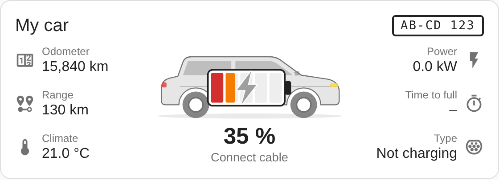
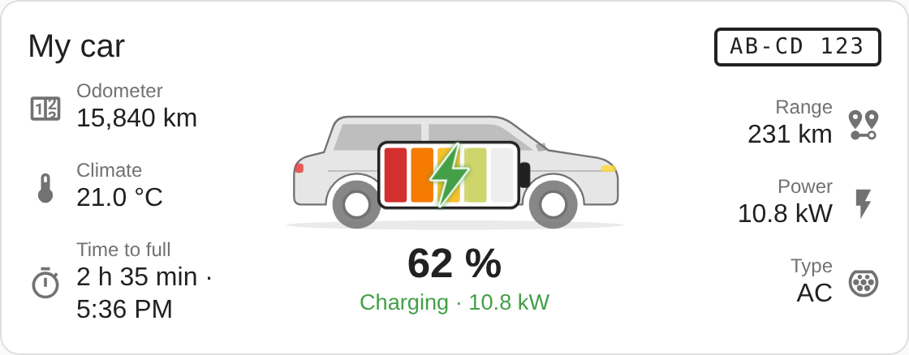
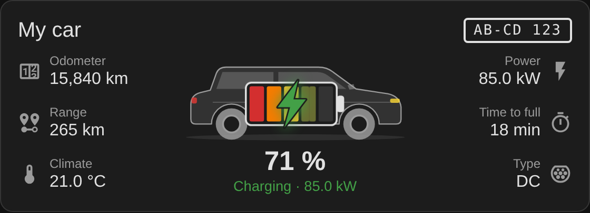
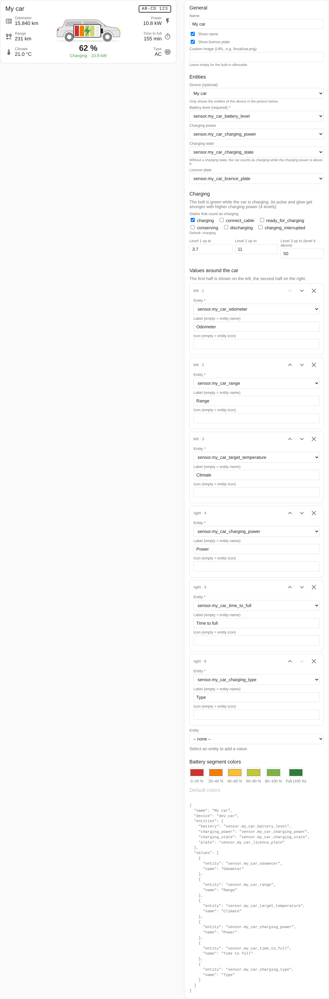

# Car Info Card

A Home Assistant dashboard card for electric cars: a generic SUV silhouette with a battery in the middle, split into 5 segments of 20 % each (red, orange, yellow, yellow-green, light green; all dark green when full), and a lightning bolt inside. The bolt is grey while the car is not charging and green while it charges; its pulse, glow and size follow the charging power. Any values you like (odometer, range, charging power, time to full, target temperature, …) are shown around the car.

> Status: **0.2.0**, early version. Not yet tested in a real Home Assistant during charging.





## Features

- Battery with 5 colour segments; the partly filled segment shows the exact level and blinks while charging
- All segments turn dark green only when the battery is full, so 85 % never looks full
- Charging bolt in 4 power levels (default limits 3.7 / 11 / 50 kW, configurable)
- Works with any integration: all entities are assigned in the configuration
- Values on the left and right of the car; two columns below the car on narrow cards
- Optional own image instead of the built-in silhouette
- Visual card editor; pick your car's device to see only its entities
- Light and dark themes, respects "reduced motion"
- User interface in English and German (follows the Home Assistant language)

<!-- ha-marketplace:exclude-start -->
## Installation

### Marketplace

[](https://my.home-assistant.io/redirect/marketplace_repository/?owner=Zebru1902&repository=car-info-card&category=plugin)

The link opens this repository in the Marketplace of your Home Assistant (2026.11 or later) and offers to add it. The card is not in the default catalog yet.

### Manual

1. Copy `car-info-card.js` (attached to the latest release, or from `dist/`) to `<config>/www/community/car-info-card/`.
2. Settings → Dashboards → ⋮ → Resources → add `/local/community/car-info-card/car-info-card.js` as **JavaScript module**.
3. Reload the browser (clear the cache).
<!-- ha-marketplace:exclude-end -->

## Configuration

Add the card via "Add card" → "Car Info Card" and use the editor, or in YAML:

```yaml
type: custom:car-info-card
name: My car
device: 0123456789abcdef0123456789abcdef  # optional, set by the editor
entities:
  battery: sensor.my_car_battery_level          # required
  charging_power: sensor.my_car_charging_power  # optional
  charging_state: sensor.my_car_charging_state  # optional
  plate: sensor.my_car_license_plate            # optional
values:
  - entity: sensor.my_car_odometer
    name: Odometer
  - entity: sensor.my_car_range
    name: Range
  - entity: sensor.my_car_target_temperature
  - entity: sensor.my_car_time_to_full
    name: Time to full
    icon: mdi:timer-outline
```

| Option | Default | Description |
|---|---|---|
| `name` | – | Title |
| `show_name` | `true` | Show the name in the header |
| `show_plate` | `true` | Show the licence plate in the header (needs `entities.plate`) |
| `device` | – | Device ID; only used by the editor to show just this device's entities in the pickers |
| `entities.battery` | – | State of charge in % (required) |
| `entities.charging_power` | – | Charging power; W, kW and MW are converted |
| `entities.charging_state` | – | Charging state; without it, power > 0 counts as charging |
| `entities.plate` | – | Licence plate |
| `charging_states` | `[charging]` | States of `charging_state` that count as charging |
| `power_levels` | `[3.7, 11, 50]` | kW limits of bolt levels 1–3; above that level 4 |
| `colors` | red, orange, yellow, yellow-green, light green, dark green | 5 segment colors (0–20 % … 80–100 %) plus an optional 6th color used for all segments when fully charged |
| `image` | – | Own image instead of the silhouette, e.g. `/local/car.png` |
| `values` | `[]` | List of `entity` (+ optional `name`, `icon`); first half on the left, second half on the right |



The editor screenshot uses a simplified stand-in for Home Assistant's form element (`preview/ha-form-stub.js`); in Home Assistant the fields look as usual. ⚠️ NOT VERIFIED: look and behaviour of the editor in a real Home Assistant 2026.11.

Tapping a value or the battery opens the entity's more-info dialog. Values are formatted by Home Assistant itself, so units and translations come from the integration.

## Development

```bash
npm install
npm run build     # builds dist/car-info-card.js (Lit bundled)
npm run preview   # build + Playwright screenshots in docs/screenshots
npm test          # build + editor test in the browser (Playwright)
```

`preview/index.html` simulates the `hass` object with example values. UI strings live in `src/localize.js`; add a language there to translate the card.

## License

MIT, see [LICENSE](LICENSE).
